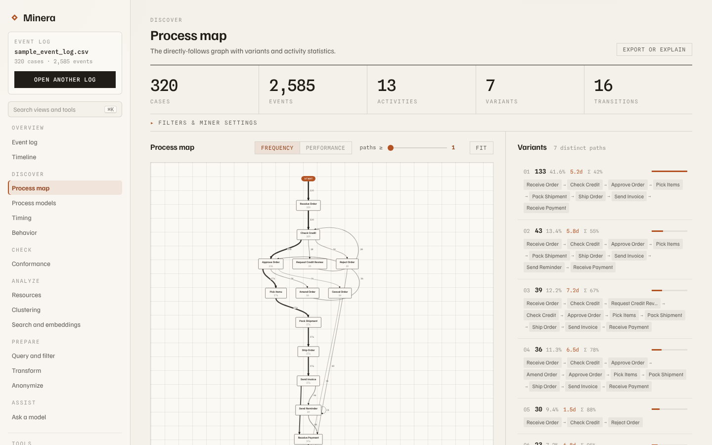
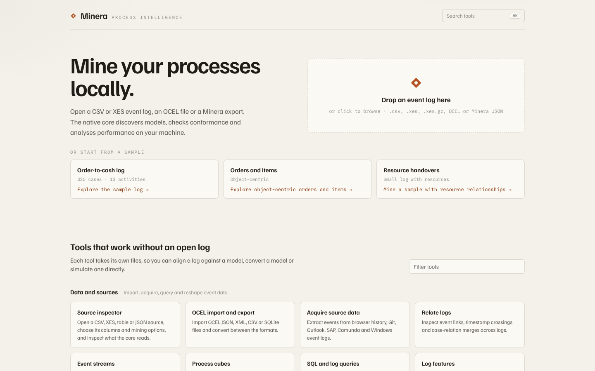

<h1 align="center">Minera</h1>

<p align="center">
  <strong>Process mining that runs on your machine.</strong><br>
  A native C++20 engine with command-line tools, a local server and a React app.
</p>

<p align="center">
  <a href="LICENSE"></a>
  
  
  
</p>

<p align="center">
  
</p>

Minera reads CSV, XES and OCEL event logs, discovers process models, checks
conformance, simulates models and analyses performance, all in one native
process. Your logs never leave your computer, and nothing needs Python at run
time.

## Highlights

- **Local and fast.** One native process for import, mining and analysis,
  with a browser front end served from `localhost`.
- **Broad.** Classic and object-centric process mining, from discovery and
  conformance to simulation, streaming and language-model assistance.
- **Checked against a reference.** Every package and module of the PM4Py
  2.7.22 release maps to a Minera implementation, with the evidence recorded
  in the repository and verified in CI.

## What it can do

| Area | Included |
| --- | --- |
| Logs and models | CSV, XES and gzip XES import and export; OCEL 2.0 as JSON, XML, SQLite and CSV; PNML, BPMN, PTML, POWL and DFG models |
| Discovery | Alpha and Alpha+, Inductive, Heuristics, ILP, genetic, directly-follows graphs, POWL, Declare, Log Skeleton, footprints, transition systems, temporal profiles |
| Conformance | Token-based replay; alignments on Petri nets, process trees and DFGs, including decomposed alignments; Declare, Log Skeleton and temporal-profile checks; fitness, precision, generalisation and simplicity |
| Performance and people | Timing and performance spectra, batches, resource profiles, social and organisational networks |
| Object-centric | OCEL import, export and preparation, object-centric DFGs and Petri nets, object graphs and object-centric conformance |
| Preparation | Filters on attributes, time, variants, paths, LTL patterns and more; feature extraction; clustering; anonymisation (SaCoFa, Laplace) |
| Simulation and streams | Play-out, Monte Carlo simulation, live event streams and Declare prefix monitoring, process cubes |
| Data sources | Browser history, Git, Outlook, SAP, Camunda and Windows event logs |
| Assistance | Log and model descriptions for language models (OpenAI, Anthropic, Google or a local model), SQL over logs with DuckDB |

The [feature guide](docs/feature-guide.md) describes every algorithm, CLI
flag, API route and frontend workspace in detail.

## Quick start

You need CMake 3.20 or newer, a C++20 compiler (GCC 12+, Clang 15+ or MSVC
2022) and Node 22 for the frontend.

```sh
cmake -S . -B build -G Ninja -DCMAKE_BUILD_TYPE=Release -DMINERA_BUILD_TESTS=OFF
cmake --build build -j4
(cd src/frontend && npm ci && npm run build)
./build/minera_server        # then open http://localhost:8484
```

The start screen takes a CSV or XES log. `data/sample_event_log.csv` is a
small order-to-cash sample to try first.

<p align="center">
  
</p>

## Build and test

```sh
cmake -S . -B build -G Ninja -DCMAKE_BUILD_TYPE=Release
cmake --build build -j4
ctest --test-dir build -j4 --output-on-failure
```

A clean build with tests takes about 35 minutes on 4 cores, and `ccache` is
used automatically when it is installed. Test sources compile at `-O0` by
default (`MINERA_TEST_OPTIMIZATION`) because they embed large generated
fixtures; the library keeps the build type's optimisation. Configure with
`-DMINERA_BUILD_TESTS=OFF` to build only the library and the tools.

Named time zones use the standard library's C++20 time-zone database where it
exists (libstdc++ 14+, MSVC). Apple's libc++ does not ship one, so on macOS
CMake detects that and builds the vendored `third_party/date` library, which
reads the system zoneinfo instead. Configure with `-DMINERA_PORTABLE_TZDB=ON`
to use that backend on any POSIX system, or `OFF` to require the standard one.

## Using Minera

### Server and app

`minera_server` serves the app and its API. It answers only browsers on its
own origin and on the Vite dev and preview ports (5173 and 4173). Add other
origins with `--allow-origin https://example.org`, which you can repeat.

### Command line

The CLI tools in `build/` (`minera_export`, `minera_ocel`, `minera_playout`,
`minera_dfg` and about 30 more) cover the same algorithms without the server.
Run a tool with `--help` to print its usage; the few tools that do not take
`--help` print it when run without arguments. To convert a log without mining
it, run `minera_export LOG --convert-only --xes OUT.xes`.

### Library

```cpp
#include "minera/csv_event_log_importer.hpp"
#include "minera/directly_follows_graph.hpp"

auto log = minera::import_csv_event_log("event_log.csv");
auto graph = minera::discover_directly_follows_graph(log);
auto count = graph.edge_count("Register request", "Check ticket");
```

By default the CSV importer expects `case_id`, `activity` and optionally
`timestamp`, `resource` and `lifecycle` columns.

<details>
<summary><strong>Size and memory limits</strong></summary>

Minera holds roughly 17 times an XES document's size in memory while it
imports and mines it, so the defaults suit a machine with 8–16 GB of RAM:

| Limit | Default | Change it with |
|---|---|---|
| Upload to `minera_server` (any route) | 128 MiB | fixed |
| XES document, plain or after gzip expansion | 256 MiB (about 4.3 GB of RAM) | `--xes-max-decompressed-bytes` (`minera_export`), `xes_max_decompressed_bytes` (request field, up to the server ceiling) |
| Highest `xes_max_decompressed_bytes` a server request may ask for | 2 GiB | `minera_server --max-xes-decompressed-bytes N` |
| OCEL JSON and OCEL XML documents | 128 MiB | fixed |
| OCEL downloads generated by the server | 128 MiB | fixed |
| Estimated memory of one `/api/mine` (10 KiB per event, plus 2 KiB per event for each column beyond case, activity, timestamp and resource) | half of the physical memory (or of the container's limit) | `minera_server --mine-memory-budget BYTES` (suffix K, M, G or T allowed) |
| Events in one `/api/mine` | no limit besides the memory estimate | `minera_server --max-mine-events N` |
| `/api/mine` requests running at once | 1 | fixed |

A larger XES log can still be uploaded as `.xes.gz`: the server reads gzip
directly, so a compressed upload under 128 MiB may hold up to 256 MiB of XES,
or more when the request raises `xes_max_decompressed_bytes`. A request may
raise it up to the server's ceiling (2 GiB unless `minera_server` was started
with `--max-xes-decompressed-bytes`); above that it gets a 400 that names the
flag.

`/api/mine` counts the upload's CSV rows or XES `<event>` tags before parsing
anything (a gzip XES is counted as it inflates). A log whose estimate passes
the memory budget or `--max-mine-events` gets 413 with family `MINE_LIMIT`,
the estimated events and bytes, the limit and a hint; the app shows that
message. Sampling or filter controls do not lift the cap, because the whole
upload is imported and kept as the source. The browser checks the size before
uploading and names the limit.

While one mine runs, another gets 503 with `Retry-After` ("Another log is
being mined — wait or cancel it."); a canceled or replaced mine stops at its
next stage, and the app retries a mine that waits only for a canceled one.
With zlib, the server gzips JSON and text responses for clients that send
`Accept-Encoding: gzip` (a mining response shrinks about tenfold); range
requests are answered uncompressed.

</details>

## Reference parity

Minera's behavioural target is the pinned PM4Py 2.7.22 release, tag commit
`0715c31f3f1d85924107d6aa5329806db69df899`. The
[parity contract](docs/reference-2.7.22-parity.md) maps every reference package
and module to a Minera implementation, and
[`docs/reference-2.7.22-coverage.json`](docs/reference-2.7.22-coverage.json)
records the evidence for each. All 86 packages and all 387 modules are marked
complete, and CI runs the verifier with `--require-complete`.

Where the reference is deterministic, Minera matches it exactly. Where the
reference depends on hash seeds or solver tie-breaking (some alignment ties,
search counters and decomposed recomposition), the tests check invariants
instead: the result is valid, optimal and cost-consistent.

The server and the CLI use reference-compatible implementations for the ILP
miner, the genetic miner, process-tree alignments, decomposed alignments,
SaCoFa trace-variant queries, OCPN and object-centric causal-net playout, and
Petri usage comparison. Native options that the reference does not have (state
and time limits, custom costs), and inputs the reference cannot handle (for
example a process tree with an operator a variant does not cover), still run
Minera's earlier native implementations. The
[handoff log](docs/PARITY_HANDOFF.md) has the per-package history.

PM4Py is not bundled with Minera and is not needed to build or run it. Only
the parity tooling uses it: the capture scripts in `scripts/` expect a copy you
install yourself, and the CI parity job checks out the pinned commit from the
reference's public repository.

## Tests and CI

`.github/workflows/ci.yml` runs five jobs on every push to `main`, every pull
request and on manual dispatch:

- **native**: Release build and the full `ctest` suite on Ubuntu 24.04.
- **native-cross**: the same build and `ctest` on macOS 26 and Windows
  Server 2022.
- **python**: the script tests (`python -m unittest discover -s scripts/tests`).
- **frontend**: `tsc --noEmit` and `vitest run` in `src/frontend`.
- **parity**: the parity verifier's self-tests, then the verifier against the
  pinned reference commit, with `--require-complete`.

To run the parity verifier locally, check out the reference at commit
`0715c31f3f1d85924107d6aa5329806db69df899`, tag it `2.7.22`, and run:

```sh
node scripts/verify-reference-parity.mjs /path/to/reference-2.7.22 --require-complete
```

## Repository layout

| Directory | Contents |
| --- | --- |
| `include/minera/` | Public C++ headers. The reference-compatible implementations are the `*_reference*.hpp` headers. |
| `src/backend/` | Library sources; `tools/` holds the CLI and server, `tests/` the CTest suites. |
| `src/frontend/` | The React/Vite application and its tests. |
| `scripts/` | Reference capture scripts, the parity verifier and helpers. |
| `docs/` | The parity contract, coverage manifest, handoff log, feature guide and evidence. |
| `data/` | The sample event log. |
| `third_party/` | Vendored build dependencies. |

## Acknowledgements

Minera owes a great deal to [PM4Py](https://github.com/process-intelligence-solutions/pm4py).
Its breadth and its openness inspired this project, and its 2.7.22 release is
the reference that Minera's behaviour is tested against. Thank you to Process
Intelligence Solutions, to the Fraunhofer Institute for Applied Information
Technology FIT, where PM4Py began, and to everyone who has contributed to it.
Thanks also to the process-mining researchers whose published algorithms both
projects implement.

Minera is an independent project and is not affiliated with or endorsed by the
PM4Py developers. Some of Minera's text, such as language-model prompt
templates and database extraction queries, reproduces PM4Py's so that the
results match; [NOTICE](NOTICE) lists it.

## License

Minera is free software under the
[GNU Affero General Public License v3.0 or later](LICENSE). Vendored
third-party code and data keep their own licences; [NOTICE](NOTICE) lists them.
